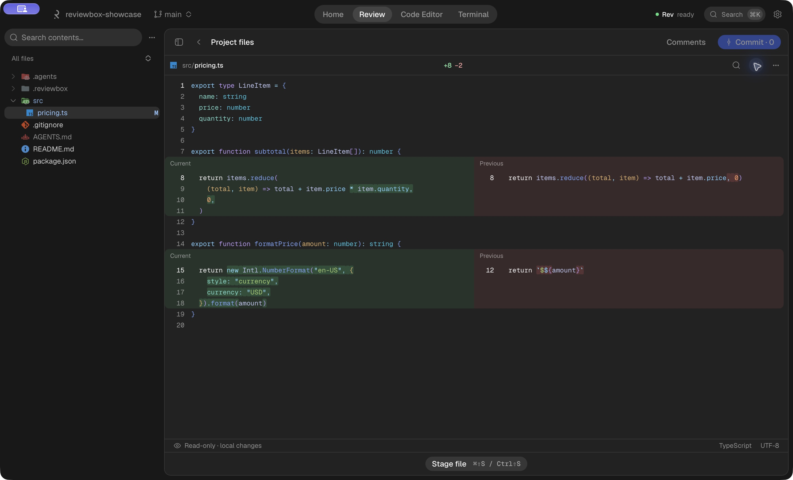

# ReviewBox

**Understand the change. Review with context. Keep the final say.**

ReviewBox is a desktop workspace for reading, editing, and reviewing code in local
Git repositories. Rev, its AI assistant, turns a set of changes into a guided
reading experience, while you keep access to the source, diffs, and Git actions.



_An actual capture of the macOS app using a fictional project._

## What you can do

- **Review with Rev.** Prepare a reading plan and documents with Codex or Claude
  Code. Choose Essential, Explained, Technical, or your own writing instructions.
- **Check the source.** Explore files and diffs, search filenames or contents, and
  leave manual review comments. Human validation stays separate from AI output.
- **Edit in context.** Use Monaco tabs, Markdown previews, recoverable drafts, and
  language support powered by native LSP servers and extensible language packs.
- **Work with Git.** Inspect local changes, stage or unstage files, and prepare
  commits with Rev. Review completion and committing are separate actions.
- **Stay in the workspace.** Open multiple integrated terminal sessions and switch
  between editing, reviewing, and the terminal.
- **Update a review.** Ask Rev to adapt its documents when the code changes, with
  explicit progress, cancellation, and recovery of saved preparation work.

The project is under active development. **`dev` contains the latest work**;
`main` may lag behind it. The screenshot and feature overview describe `dev`.
macOS is the currently validated desktop platform; Windows and Linux support is
not yet verified.

## Run locally

On macOS, install Git, Xcode Command Line Tools, **Bun 1.3.14**, and
**Rust 1.95.0**. For AI-assisted features, configure a supported Codex or Claude
Code installation with its own authentication. Editing and local Git inspection
do not require a model session.

```sh
git clone https://github.com/reviewbox-app/reviewbox.git
cd reviewbox
git switch dev
bun install --frozen-lockfile
bun run dev
```

This starts the Next.js frontend and the Tauri desktop app. `bun run dev:web`
starts only the frontend; native file, Git, terminal, and provider operations
require Tauri.

To create a local macOS bundle:

```sh
bun run build
```

The app is written to `src-tauri/target/release/bundle/macos/ReviewBox.app`.
A local build is not a notarized distribution release.

## Data and AI

ReviewBox works with local repositories. Project collaboration data lives under
`.reviewbox`; private drafts use `.reviewbox/.local`, while personal preferences
and runtime state use private application storage. ReviewBox does not manage a
separate user account or store your provider's sign-in credentials.

**Local storage does not mean offline AI.** When you use Rev, the configured
harness sends the relevant code and context to its model provider. ReviewBox
keeps human review decisions separate from generated documents. Document
preparation reads captured sources; editing, terminal commands, and Git actions
are distinct capabilities.

## Development

The frontend is a statically exported **Next.js / React** application inside
**Tauri 2**. **Rust** owns privileged operations, Git, snapshots, storage, and
processes. **Bun** manages frontend tooling. The editor uses **Monaco**, **Shiki**,
and LSP; the terminal uses **xterm.js** and **portable-pty**.

| Command                                  | Purpose                                                            |
| ---------------------------------------- | ------------------------------------------------------------------ |
| `bun run check`                          | Generated contracts, TypeScript, lint, format, rustfmt, and Clippy |
| `bun run test`                           | Frontend unit tests                                                |
| `bun run test:rust`                      | Native tests                                                       |
| `bun run test:web`                       | Browser tests                                                      |
| `bun run contracts:generate`             | Regenerate the Rust-to-TypeScript contracts                        |
| `bun run build:storage`                  | Inspect build artifact size and available space                    |
| `bun run build:clean --apply --compiled` | Remove disposable compiled caches after validation                 |

Use the guarded package build scripts and a single `src-tauri/target` directory.
Run native checks sequentially. The build guard refuses to start above 20 GiB of
artifacts or below 10 GiB of free space; do not clean caches while a compiler is
running. Bundles and installed apps are preserved by the cleanup command.

Project-specific design notes, internal documentation, and local agent
instructions are intentionally not distributed in this repository. Runtime
prompts and imported project skills remain in `resources/agents/`.

## License

ReviewBox's original code is released under the [MIT License](LICENSE). You may
use, modify, and distribute it for commercial or non-commercial purposes, provided
you retain the copyright and license notice. It comes without warranty.

Third-party dependencies and assets retain their own licenses. Bundled notices
are preserved in [`public/licenses/`](public/licenses/) and alongside relevant
source assets; The MIT License does not replace those terms.
